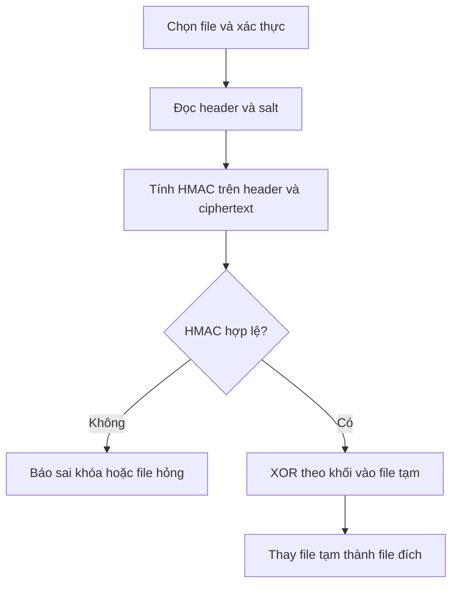

# Báo cáo kỹ thuật: XORT

## 1. Mục tiêu

XORT là công cụ học tập để khảo sát XOR lặp khóa, định dạng file có phát hiện sửa đổi và các lỗi tích hợp thường gặp khi xử lý file lớn. Dự án không nhằm tạo một hệ thống mã hóa dùng trong thực tế.

## 2. Cơ sở lý thuyết

### XOR

Với byte dữ liệu $P_i$ và byte khóa $K_{i \bmod L}$, repeating-key XOR tạo $C_i = P_i \oplus K_{i \bmod L}$. Vì $x \oplus k \oplus k = x$, cùng thao tác XOR với cùng vị trí khóa khôi phục dữ liệu ban đầu. Phép toán này nhanh và đối xứng, nhưng không tự cung cấp tính bí mật hay xác thực.

### Repeating-key XOR

Khóa ngắn được lặp trên toàn thông điệp. Những vị trí cách nhau bội số của độ dài khóa dùng cùng byte khóa, làm lộ cấu trúc thống kê của plaintext. Có thể xếp hạng độ dài khóa bằng khoảng cách Hamming chuẩn hóa giữa các khối ciphertext, sau đó tách ciphertext thành các cột và giải từng cột như XOR một byte. Điểm tần suất tiếng Anh giúp lựa chọn byte khóa có khả năng cao.

### One-Time Pad

One-Time Pad đạt bí mật thông tin lý tưởng khi khóa thực sự ngẫu nhiên, dài ít nhất bằng thông điệp, được giữ bí mật và chỉ dùng một lần. Khóa không lặp nên phương pháp đo độ dài khóa và phân tích cột của repeating-key XOR không áp dụng được. Nếu tái sử dụng pad, tính chất này mất đi.

### Stream cipher và AES

Stream cipher an toàn tạo keystream bằng thuật toán mật mã đã được phân tích, quản lý nonce/counter đúng cách và thường kết hợp xác thực. AES là block cipher chuẩn hóa; trong ứng dụng mới nên dùng thư viện tin cậy với chế độ authenticated encryption như AES-GCM hoặc ChaCha20-Poly1305. Không tự ghép XOR, HMAC hay nonce để thay thế một thư viện mật mã đã được kiểm chứng.

| Đặc tính | XOR lặp khóa trong demo | AES-GCM qua thư viện chuẩn | One-Time Pad |
|---|---|---|---|
| Bí mật | Không an toàn khi khóa lặp | Được thiết kế cho ứng dụng thực tế nếu dùng đúng | Lý tưởng dưới các giả định nghiêm ngặt |
| Xác thực | Không có; XORT thêm HMAC để phát hiện sửa đổi | Có xác thực tích hợp | Không có nếu không bổ sung cơ chế |
| Quản lý khóa | Khóa ngắn lặp lại | Khóa và nonce theo thư viện/giao thức | Pad dài bằng thông điệp, ngẫu nhiên và dùng một lần |
| Mục đích dự án | Minh họa điểm yếu | Gợi ý lựa chọn cho ứng dụng thực | Mốc lý thuyết |

## 3. Thiết kế

### Luồng mã hóa

1. Kiểm tra chỉ có đúng một trong mật khẩu/keyfile.
2. Sinh salt 16 byte và dẫn xuất khóa XOR/HMAC.
3. Ghi header, XOR file theo khối 1 MiB và cập nhật HMAC.
4. Ghi HMAC rồi thay file tạm vào đường dẫn đích.

### Luồng giải mã

1. Kiểm tra kích thước và header.
2. Dẫn xuất khóa, tính lại HMAC trên header+ciphertext.
3. So sánh bằng `hmac.compare_digest`; nếu sai thì không tạo file đích.
4. Nếu đúng, XOR lượt hai vào file tạm và thay vào đích.

### Định dạng `.enc`

| Offset | Kích thước | Nội dung |
|---:|---:|---|
| 0 | 4 byte | `MAGIC = b"XORT"` |
| 4 | 1 byte | `VERSION = 1` |
| 5 | 16 byte | Salt ngẫu nhiên |
| 21 | 8 byte | Kích thước plaintext, big-endian |
| 29 | N byte | Ciphertext XOR |
| Cuối file | 32 byte | HMAC-SHA256(header + ciphertext) |

File hợp lệ có độ dài `29 + N + 32` byte.

## 4. Kết quả kiểm thử và phân tích

Chạy `python -m pytest -q` để thực thi các test khứ hồi, biên khối, keyfile, mật khẩu tiếng Việt, sai mật khẩu, sửa header/ciphertext/HMAC, file thường, cắt cụt, fixture đa định dạng và hủy tác vụ giữa các chunk. Trên interpreter VS Code Python 3.14.7, **37 test passed**. Bộ benchmark trên sample tiếng Anh tự tạo đạt kết quả trong [docs/BREAKER_RESULTS.csv](BREAKER_RESULTS.csv). Với plaintext dài 512 byte, tỷ lệ byte khôi phục là 97.3% cho khóa 4, 6 và 12 byte, 100% cho khóa 8 và 10 byte. Ở 2,048, 4,096 và 8,192 byte, các khóa được đo đều đạt 100%. Không suy rộng sang văn bản ngôn ngữ khác vì breaker dùng mô hình tần suất tiếng Anh.

Đối với file lớn, vòng lặp đọc/ghi giữ bộ nhớ theo kích thước khối. Trên interpreter VS Code Python 3.14.7, XOR khứ hồi file 200 MiB và so SHA-256 thành công trong 4.4 giây. Kết quả phụ thuộc thiết bị; GUI 500 MiB vẫn cần kiểm tra thủ công. Bài kiểm tra 200 MiB có thể sinh bằng `python -m tests.make_testdata --include-large`.

## 5. Hạn chế và hướng phát triển

- XOR lặp khóa không bảo vệ bí mật, kể cả khi có HMAC.
- HMAC xác thực dữ liệu nhưng không mã hóa an toàn; XORT chỉ là định dạng thực hành.
- Breaker được tối ưu cho văn bản tiếng Anh đủ dài; dữ liệu ngắn, tiếng Việt UTF-8 hoặc plaintext không phải văn xuôi có thể làm sai kết quả.
- Nên dùng thư viện mật mã chuẩn với authenticated encryption, thêm định dạng versioned có nonce, và kiểm tra tương thích chéo nền tảng.

## 6. Phần việc theo nhóm

| Người | Phạm vi triển khai trong repo |
|---|---|
| 1 | XOR theo byte/stream/file, SHA-256, tiến trình, hủy và test core |
| 2 | Lớp lỗi, dẫn xuất khóa, keyfile, định dạng file, HMAC và test |
| 3 | GUI Tkinter, xử lý nền qua queue, chọn file, hủy và demo |
| 4 | Breaker repeating-key XOR, sample tiếng Anh, benchmark |
| 5 | Fixture, pytest, README, báo cáo, checklist tích hợp |

Danh tính, tỷ lệ đóng góp, PR review, ảnh chụp và video cần được xác nhận/hoàn thành bởi nhóm (xem checklist). Nội dung chi tiết theo vai trò nằm trong [docs/TEAM_CONTRIBUTIONS.md](TEAM_CONTRIBUTIONS.md), bản nháp slide trong [docs/SLIDES.md](SLIDES.md).